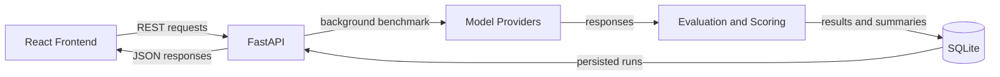

# LLM Evaluation Framework

An end-to-end benchmarking platform that runs repeatable LLM evaluations through a FastAPI backend and a React dashboard.

[](https://github.com/mariamneffeti/LLM_Evaluation_Framework/actions/workflows/ci.yml)
[](https://www.python.org/)
[](LICENSE)

## Demo

> Add a product demo GIF or dashboard screenshot here when available.


## Features

- Start model benchmarks through a REST API or the React dashboard.
- Run multiple configured model providers against a JSONL question dataset.
- Score answer accuracy, groundedness, token usage, and latency.
- Persist run results and model summaries in SQLite.
- Review previous runs and compare benchmark summaries in the dashboard.
- Run the frontend and backend locally or with Docker Compose.

## Architecture



## Stack

- **Backend:** Python, FastAPI, Pydantic, SQLAlchemy
- **Frontend:** React
- **Evaluation:** Python benchmark runner and heuristic scoring
- **Persistence:** SQLite
- **Providers:** Groq, GitHub Models, Google Gemini, and local Ollama
- **Delivery:** Docker, Docker Compose, and GitHub Actions

## Quickstart

### Docker Compose

1. Copy the example configuration and add credentials for any hosted models you plan to use:

   ```bash
   cp .env.example .env
   ```

2. Start the services:

   ```bash
   docker compose up --build
   ```

3. Open the dashboard at [http://localhost:3000](http://localhost:3000) or the API at [http://localhost:8000](http://localhost:8000).

### Manual setup

Start the backend in the repository root:

```bash
python -m venv .venv
# Windows: .venv\Scripts\Activate.ps1
source .venv/bin/activate
python -m pip install -r backend/requirements.txt
python backend/app.py
```

In another terminal, install and start the React frontend:

```bash
cd frontend
npm install
npm start
```

The frontend uses `http://localhost:8000` by default. Hosted provider credentials are optional for browsing the API and running tests; add them to `.env` to benchmark those providers. Ollama requires a locally running Ollama service and the configured model.

## API Endpoints

| Method | Endpoint | Description |
| --- | --- | --- |
| `GET` | `/` | API name and version |
| `GET` | `/health` | Health status |
| `GET` | `/models` | Configured model identifiers |
| `POST` | `/benchmark/run` | Queue a benchmark run |
| `GET` | `/benchmark/{run_id}` | Retrieve a run’s results and summary |
| `GET` | `/benchmarks` | List recent benchmark runs |
| `GET` | `/benchmarks/compare?run_ids=id1,id2` | Retrieve summaries for selected runs |

Example request:

```bash
curl -X POST http://localhost:8000/benchmark/run \
  -H "Content-Type: application/json" \
  -d '{"dataset_path":"data/dataset.jsonl","models":["gpt-4o-mini"]}'
```

## Supported Models

| Provider | Model identifier | Availability |
| --- | --- | --- |
| Groq | `llama-3.1-70b-versatile` | Requires `GROQ_API_KEY` |
| GitHub Models | `gpt-4o-mini` | Requires `GITHUB_TOKEN` |
| Google Gemini | `gemini-2.0-flash` | Requires `GOOGLE_API_KEY` |
| Ollama | `llama3.1:8b` | Requires a local Ollama service and model |

## Configuration

`.env.example` documents the optional provider credentials, local database and dataset settings, and frontend/backend ports. Copy it to `.env` for local use, then fill in only the credentials for providers you intend to call. `.env` is ignored by Git. Tests use a mocked provider and do not need credentials.

| Variable | Purpose |
| --- | --- |
| `GROQ_API_KEY` | Groq API access |
| `GITHUB_TOKEN` | GitHub Models API access |
| `GOOGLE_API_KEY` | Gemini API access |
| `DATABASE_URL` | Documented local SQLite connection setting |
| `DATASET_PATH` | Default benchmark dataset path |
| `REACT_APP_API_URL` | Backend URL used by the frontend |

The benchmark endpoint accepts `dataset_path` and `models` in its JSON request. When `models` is omitted, it uses all configured model identifiers.

## Testing

Install the backend dependencies and pytest, then run the test suite from the repository root:

```bash
python -m pip install -r backend/requirements.txt pytest
python -m pytest tests/ -v
```

The API tests use FastAPI’s `TestClient`; the evaluation test supplies a local fake provider. No real provider calls or API keys are needed. GitHub Actions runs pytest on pushes and pull requests.

## Project Structure

```text
.
├── backend/                 # FastAPI application, schemas, and SQLite setup
├── data/                    # Small sample JSONL dataset
├── eval/                    # Benchmark runner, scoring, and reporting
├── frontend/                # React dashboard and API client
├── providers/               # Provider adapters and shared response interface
├── tests/                   # API and mocked evaluation tests
├── .github/workflows/       # CI and project automation
├── Dockerfile
├── docker-compose.yml
└── README.md
```

## Key Technical Decisions

- **Background execution:** The API queues benchmark work with FastAPI background tasks and returns a run ID so the dashboard can retrieve results separately.
- **Provider abstraction:** Each provider implements a common `complete` interface and returns a shared response shape, so the benchmark runner can evaluate providers uniformly.
- **Persistence:** SQLAlchemy stores each run’s result list and summary as JSON fields in SQLite.
- **SQLite:** A file-backed database keeps local setup and portfolio demos simple while retaining benchmark history across restarts. It suits this single-instance project; a multi-instance deployment would need a shared database service.
- **Scoring:** Accuracy uses normalized exact-answer containment, groundedness uses expected-answer keyword overlap, and token counts come from provider responses.

## Results

Add measured results from reproducible benchmark runs. No sample measurements are published yet.

| Model | Accuracy | Grounded | Input Tokens | Output Tokens | Latency ms |
| --- | --- | --- | --- | --- | --- |
| _Add benchmark result_ | — | — | — | — | — |

## Roadmap

- [ ] WebSocket support for real-time updates
- [ ] Export to CSV/PDF
- [ ] Model fine-tuning integration
- [ ] A/B testing framework
- [ ] Cost analytics dashboard
- [ ] Multi-user support with authentication
- [ ] Webhook notifications
- [ ] Model registry with versioning

## License

This project is licensed under the [MIT License](LICENSE).

## Contact

**Mariam Neffeti** · [GitHub](https://github.com/mariamneffeti)
